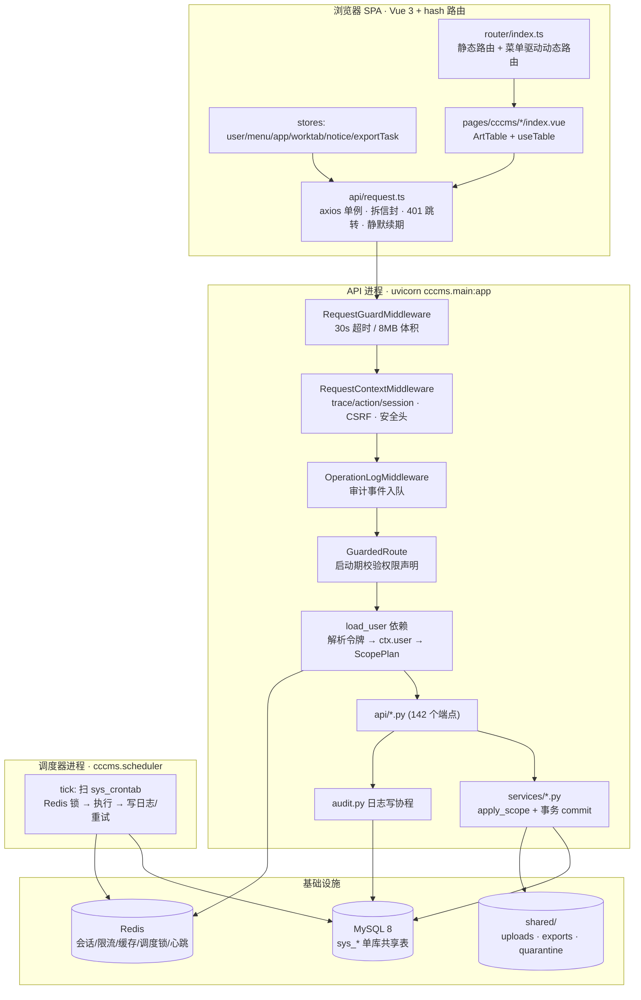

# CCCMS 项目体检与竞品分析

> 体检日期：2026-10-22｜视角：外部技术顾问｜范围：只读诊断，不含实现代码
> 环境：Windows + PowerShell｜后端 `uv run`（Python 3.12）｜前端 `npm`
> 报告位置说明：项目已有 `docs/`，故写入 `docs/`，不另建 `reports/`。理由：`docs/` 已是被 README 索引的文档根，报告与设计文档同处一处便于对照。
>
> **关于 `AGENTS.md`**：分析开始时根目录存在 `AGENTS.md`（会话首帧目录列举可见，内容由 IDE 提供，本报告已全文遵守其约定）。撰写本报告前再查时，该文件已不在工作区，且 `git ls-files` 显示它**从未被 git 跟踪**。相关影响见 P1-6。

---

## 0. 项目背景推断表（第 0 阶段产物）

| 项 | 结论 | 来源（相对路径） | 置信度 |
|---|---|---|---|
| 项目形态 | 单体仓库 + 两个可部署进程（FastAPI API、独立调度器）+ 1 个 SPA 前端；**无** workspace/多包编排；仓库里同时存在一个**未删净的旧 PHP 实现**（`server/`，306 个文件仍在 git 索引中，磁盘上已删） | 根目录结构；`backend/pyproject.toml#L59`（`package = true`，src 布局）；`git ls-files server` = 306；`git status` 中 `D server/*` | 确认 |
| 项目是什么 | "可直接作为企业级项目起点的中后台管理系统"；`pyproject.toml` 自述为 **Python rewrite**（即旧 PHP/webman 系统的重写） | `README.md#L22`；`backend/pyproject.toml#L4` | 确认 |
| 目标用户 | 需要"开箱即用中后台底座"的中小型研发团队 / 外包交付方 / 自建内部平台的 SaaS 团队（同时要 RBAC、多租户、数据权限的人） | `README.md#L22-L35` 的能力清单与"安全默认值做对"的定位；无用户画像章节（`docs/01-项目介绍.md` 亦无） | 推断（依据功能集与定位措辞反推） |
| 技术栈 | 后端 FastAPI 0.115+/SQLAlchemy 2.0 async/asyncmy/Pydantic v2/Alembic/Redis/croniter；前端 Vue 3.5 + Vite 5 + TS 5.7 + Element Plus 2.11 + Tailwind 4 + Pinia + vue-i18n 11 | `backend/pyproject.toml#L8-L36`；`frontend/package.json#L19-L58` | 确认 |
| 当前版本 / 阶段 | 代码版本号 **0.1.0**（4 处），但 `docs/更新日志.md` 已写到 **0.3.0**（2026-10-22）；git **无 tag**，最近 20 条 commit message 全是 `init .` | `backend/pyproject.toml#L3`、`frontend/package.json#L3`、`backend/src/cccms/main.py#L72`、`backend/src/cccms/services/upgrade.py#L111`、`docs/更新日志.md#L7`；`git tag -l` 空 | 来源冲突（见 P2-6） |
| 构建与发布 | 后端 uv + 多阶段 `backend/Dockerfile`（非 root，HEALTHCHECK）+ 根 `docker-compose.yml`（mysql/redis/migrate/api/scheduler）；前端 `npm run build`（`vue-tsc --noEmit && vite build`）；**无 CI**（仓库无 `.github/`，工作区还删了两个旧 workflow） | `backend/Dockerfile#L20-L39`；`docker-compose.yml`；`frontend/package.json#L8`；`git status` 显示 `D .github/workflows/frontend.yml`、`D .github/workflows/php.yml` | 确认 |
| 已有约定与规则 | `AGENTS.md`（硬约束，当前已不在工作区且未入 git）+ `docs/08-后端开发规范.md`、`docs/09-前端开发规范.md` + ruff/mypy(strict)/pytest 配置集中在 `pyproject.toml` | `docs/08-后端开发规范.md`、`docs/09-前端开发规范.md`、`backend/pyproject.toml#L75-L145` | 确认（AGENTS 内容为会话开始时快照） |
| 数据与状态 | MySQL 8（`utf8mb4_0900_ai_ci`，单库共享表 + `tenant_id`）+ Redis（会话/限流/缓存/调度锁）+ 本地磁盘 `shared/uploads`、`shared/exports`、`shared/quarantine`；迁移链 0001→**0004**；前端状态在 `localStorage`（token、表格列设置、筛选方案、UI 配置缓存）+ Service Worker 缓存 `/assets/*` | `backend/migrations/versions/` 四个 revision；`backend/src/cccms/config.py#L133-L136`；`frontend/src/composables/useTable.ts#L16-L18`；`frontend/src/main.ts#L92` | 确认 |

**未标"待确认"的项都有文件依据**。仅以下两条属 `待确认`，不影响后续结论方向：

| 待确认项 | 采用的默认假设 | 影响范围 |
|---|---|---|
| 是否有真实生产部署与存量数据规模 | 假设**尚未上生产**，当前是单人/小团队的重写交付阶段 | 影响 P0-3（git 未纳管）的紧迫度排序；若有生产数据，P1-2（compose 起不来）优先级升为 P0 |
| 旧 PHP 系统（`server/`）是否仍在线服务 | 假设**已停用**，仅作对照参考 | 影响"数据迁移"类建议是否需要纳入范围；本报告默认不纳入 |

---

## 1. 项目快照

### 1.1 一段话说清

CCCMS 是一套**用 Python 重写的企业级中后台系统底座**：后端 FastAPI + SQLAlchemy 2.0 async + MySQL 8 + Redis，把"鉴权、租户隔离、行/字段级数据权限、审计哈希链、定时任务、附件与导出"做成框架级能力；前端 Vue 3 + Element Plus，菜单驱动动态路由，按钮级 `v-auth`。它的设计主张不是功能多，而是**fail-closed**：路由没声明权限就启动失败（`[permissions.py](backend/src/cccms/core/permissions.py#L95-L117)`），数据权限必须在服务层显式 `apply_scope()`（`[scope.py](backend/src/cccms/core/scope.py#L320-L335)`）。当前处于**重写收尾但未纳管**的阶段：文档写到 0.3.0，代码仍是 0.1.0，后端 109 个源文件**完全未进入 git**。

### 1.2 项目地图



### 1.3 入口清单（新人第一天要看的 8 个位置）

| 入口 | 位置 | 作用 |
|---|---|---|
| 应用装配 | `[main.py](backend/src/cccms/main.py#L68-L109)` | 中间件顺序、双前缀挂载（`/api` + `/api/v1`）、启动期 `assert_route_declarations` |
| 路由清单 | `[api/__init__.py](backend/src/cccms/api/__init__.py#L39-L65)` | `BUSINESS_ROUTERS` 决定"哪些模块存在"；漏注册 = 模块消失 |
| 权限声明 | `[core/permissions.py](backend/src/cccms/core/permissions.py#L33-L136)` | `@permission` / `@no_auth` / `@no_login` + `GuardedRoute` |
| 数据权限 | `[core/scope.py](backend/src/cccms/core/scope.py#L263-L406)` | 5 档范围 + 行规则 + 字段动作（hidden/mask/encrypt） |
| 配置 | `[config.py](backend/src/cccms/config.py#L79-L292)` | 全部 `CCCMS_*`；dev 自动生成并持久化密钥 |
| CLI | `[cli.py](backend/src/cccms/cli.py#L150-L190)` | `init-db` / `migrate` / `seed` / `check` / `audit-verify` |
| 前端路由 | `[router/index.ts](frontend/src/router/index.ts#L134-L191)` | 登录判定 + 菜单拉取并行 + 动态路由注册 + 节点级拦截 |
| 前端请求 | `[api/request.ts](frontend/src/api/request.ts#L60-L160)` | 令牌注入、信封解包、401/续期/错误提示 |

### 1.4 核心链路（登录一次，看一次列表）

1. `POST /api/auth/login` → `[api/auth.py](backend/src/cccms/api/auth.py#L53-L57)` → `services/auth.py` 校验 Argon2id → 签发 JWT（`jti`、`home_tenant_id`）→ 中间件写 `Set-Cookie` + 返回 `token` 字段。
2. 前端把 token 存 `localStorage`，每次请求带 `Authorization: Bearer`；剩余有效期 < 1/3 时后端回 `X-Refresh-Token`，前端静默替换（`[request.ts](frontend/src/api/request.ts#L93-L96)`）。
3. 业务请求进 `GuardedRoute`：`load_user` 解析令牌 → 查 Redis 吊销水位 → `load_user_context`（RBAC 权限集 + 部门子树 + 有效角色 + 数据范围）→ `build_plan` 生成 `ScopePlan` → `permission_dependency` 校验 slug。
4. 服务层 `apply_scope(select(Model), Model)` 一次性拼上 `tenant_id`、软删、数据范围三组条件，再 `commit()`，返回 Pydantic 出参。
5. 响应统一信封 `{code,message,data,trace_id,action_id,session_id}`；`code != 0` 前端统一弹错并附操作 ID。
6. 全程由 `OperationLogMiddleware` 组一条审计事件入队，后台协程落库；每 10 分钟由调度任务 `cccms.audit.seal` 做哈希链 + HMAC 封存。

### 1.5 规模基线（实测）

| 指标 | 数值 | 取证方式 |
|---|---|---|
| 后端源码 | 109 个 `.py`，约 572 KB | `Get-ChildItem -Recurse *.py` + `Measure-Object` |
| 业务端点 | 142 个路由装饰器；113 个 `@permission` slug、20 个 `@no_auth`、9 个 `@no_login` | 文本统计 |
| 后端测试 | **43 passed in 1.16s**（`test_helpers.py` + `test_http_contract.py`），无需 MySQL/Redis | `uv run pytest -q`（**注**：修好 CORS 配置前会 collection error，见 P0-1） |
| 后端静态检查 | `ruff check src` → **All checks passed**；`mypy src` → **Success: no issues found in 109 source files** | 实测 |
| 前端测试 | **10 文件 / 100 tests passed**（约 2.3s） | `npm run test` |
| 前端类型/规范 | `npx vue-tsc --noEmit` 与 `eslint .` 均退出码 0 | 实测 |
| i18n | zh-CN 1179 key = en-US 1179 key，命名空间与 key 集合一致 | `npm run i18n:check` |
| 最大单文件 | `frontend/src/components/core/ArtTable.vue` 1925 行；`pages/cccms/log/index.vue` 1292 行；`pages/cccms/data_rule/index.vue` 1035 行 | 行数统计 |
| 迁移链 | 0001_baseline → 0002_hot_indexes → 0003_file_path_index → **0004_log_archive** | `backend/migrations/versions/` |

---

## 2. 问题清单

> 分级标准：P0 = 数据丢失 / 安全风险 / 核心功能不可用；P1 = 明显影响体验或存在回归风险；P2 = 可维护性、局部不一致；P3 = 打磨项。同级按影响面排序。

### P0

#### P0-1 按文档复制 `.env.example` 后，后端无法启动（配置解析必然崩）

- **级别**：P0（核心功能不可用：API、调度器、CLI 全部启动失败）
- **位置**：`[backend/.env.example](backend/.env.example#L45)`、`[backend/.env.example](backend/.env.example#L36)`、`[config.py](backend/src/cccms/config.py#L126)`、`[config.py](backend/src/cccms/config.py#L179-L184)`
- **现象**：`.env.example` 把 `CCCMS_CORS_ORIGINS` 写成逗号分隔（`http://127.0.0.1:5173,http://localhost:5173`），`CCCMS_TRUSTED_PROXIES` 留空。`Settings` 在构造阶段直接抛异常，进程连日志都来不及打。
- **证据**：
  - `.env.example#L45`：`CCCMS_CORS_ORIGINS=http://127.0.0.1:5173,http://localhost:5173`；`#L36`：`CCCMS_TRUSTED_PROXIES=`（空值）。
  - 实测（`backend/.env` 即 `.env.example` 的副本，同为 CSV 写法）：
    ```
    $ uv run python -m cccms.cli check
    SettingsError: error parsing value for field "cors_origins" from source "DotEnvSettingsSource"
    $ uv run pytest -q
    ERROR tests/test_http_contract.py - pydantic_settings.exceptions.SettingsError...
    !!! Interrupted: 1 error during collection !!!
    ```
  - 反向验证：把同一字段改成 JSON 数组（`'["http://a.test"]'`）则 `Settings` 正常构造；CSV 写法在**环境变量源**下同样失败（`EnvSettingsSource`）。
  - 根因链：`config.py#L179-L184` 的 `_split_csv` 是 `mode="before"` 校验器，但 pydantic-settings 2.16.1 对 `list[str]` 这类复杂字段会**在校验器之前**做 `json.loads`（`.venv/.../pydantic_settings/sources/base.py`：`return json.loads(value)`），失败即 `SettingsError`。同一路径下空串（`TRUSTED_PROXIES=`）也会进 `json.loads("")`，所以**只修 CORS 不够**。
- **影响**：任何按 README 第 2 步 `copy .env.example .env` 的人第一次就跑不起来；`cli init-db` / `cli seed` / `cli check` / `pytest` 全部在同一处失败。这是"上手指南第一屏"级别的故障，`docs/11-常用命令与运维.md` 与 `README.md#L84` 的整条命令序列目前不可执行。
- **建议**：三行改动即可，不要改文档去迁就代码（逗号分隔是用户预期）：
  1. 在 `Settings.model_config` 加 `enable_decoding=False`（`config.py#L80-L87`），**或**给三个字段标注 `Annotated[list[str], NoDecode]`（`cors_origins`、`trusted_proxies`、`metrics_allow_ips`）；
  2. 保留 `_split_csv` 并补一条空串用例；
  3. `.env.example` 增加一行注释说明"逗号分隔，JSON 数组也接受"。
- **验证方式**：`uv run python -m cccms.cli check` 输出 `route declarations ok`；`uv run pytest -q` 恢复 43 passed；另加单测 `test_settings_accepts_csv_and_empty_lists`（不依赖 DB），断言 `Settings(_env_file=tmp)` 对 `"a,b"`、`""`、`'["a"]'` 三种输入都能构造。
- **结论分级**：已确认事实（含命令真实输出）

#### P0-2 `/storage/**` 对**所有人**（含已登录用户）恒返回 401，附件功能整体不可用

- **级别**：P0（核心功能不可用 + 与安全文档相反的行为）
- **位置**：`[storage.py](backend/src/cccms/api/storage.py#L27)`、`[storage.py](backend/src/cccms/api/storage.py#L30-L48)`、`[permissions.py](backend/src/cccms/core/permissions.py#L80-L92)`、`[permissions.py](backend/src/cccms/core/permissions.py#L114-L117)`
- **现象**：附件上传能成功、数据库有记录、接口返回 `url: /storage/2026/10/22/xxx.png`，但任何人（包括刚登录的超管）打开这个 URL 都是 401。系统里**没有第二个附件下载入口**。
- **证据**：
  - `storage.py#L27` 建路由时 `auth=False`（不挂 `load_user`），`#L31` 又声明 `@no_auth`；而 `GuardedRoute.__init__` 只在 `meta.no_login` 为真时才跳过权限依赖（`permissions.py#L115-L116`），`permission_dependency` 第一件事就是 `ctx.user is None → Unauthorized`（`permissions.py#L84-L86`）。`ctx.user` 只由 `load_user` 赋值（`auth_deps.py#L87`），全仓仅此一处写入。
  - 运行时自省（把 CORS 临时覆盖为 JSON 后导入 app）：
    ```
    PATH /storage/{file_path:path} | DEPS ['_check', 'get_session'] | no_auth True | no_login False
    ```
    依赖链里**没有** `load_user` —— 所以 `_check` 永远看不到用户。
  - 现有测试把 bug 固化成了"期望"：`[test_http_contract.py](backend/tests/test_http_contract.py#L59-L62)` 只断言匿名 401，没有断言"登录后可读"。
  - 一旦有人把路由改成 `auth=True`，`apply_scope`（`storage.py#L41`）才会生效；现在它拿到的是 `scope_plan=None`，形同注释。
- **影响**：
  - 附件页缩略图/预览/新窗口查看全挂（`[file/index.vue](frontend/src/pages/cccms/file/index.vue#L103-L104)` 直接用 `row.url`）；
  - 后台配置的 `system.logo` 若指向 `/storage/...`，侧边栏与登录页 Logo 变空（`[app.ts](frontend/src/stores/app.ts#L70)`）；
  - 富文本公告里的图片、用户头像同理；
  - 与三处文档承诺相反：`README.md#L165`、`docs/16-文件与导出.md#L11`、`docs/更新日志.md#L19`（"匿名 401、不可见 404"）—— 文档描述的是**修复后的目标态**，不是现状。
  - `storage.py` 模块注释自己写的兜底出口也不存在：`"Bearer-only 客户端应改用 /api/file 列表里返回的鉴权下载入口"` —— `api/file.py` 里没有任何 download 端点（全仓 `FileResponse` 只出现在 `storage.py` 与 `export.py`）。
- **建议**：
  1. `storage.py#L27` 改为 `auth=True`（一个词的修复，保留 `@no_auth`，语义正好是"登录即可读、无需具体 slug"）；
  2. 补 `GET /api/file/{id}/download`（`get_current_user` + `apply_scope` + `FileResponse(filename=original_name)`），给纯 Bearer 客户端与"另存为"用，顺手让文档那句承诺落地；
  3. 契约测试加两条：无令牌 → 401；**有效会话读到自己的文件 → 200**，读别人的 → 404（需要 mock `load_user_context`，仍可不连 DB）。
- **验证方式**：`GET /storage/<存在的 path>` 带有效 Cookie/Bearer 返回 200 + `Cache-Control: private`；匿名仍 401；新建两条 contract 测试并让它们在此之前失败、之后通过。
- **结论分级**：已确认事实（代码路径 + 运行时依赖自省）

#### P0-3 后端 109 个源文件完全未纳入 git（0 个被跟踪），399 项变更未提交，无任何 tag

- **级别**：P0（数据丢失风险：一次误操作即可清空整份重写成果）
- **位置**：仓库根 `git` 状态；`git ls-files backend`、`git status --short`、`git log`、`git tag`
- **现象**：Python 后端是**未跟踪目录**，旧 PHP `server/` 的 306 个文件仍被跟踪（磁盘上已删）。工作区共 399 项变更未提交，20 条 commit 全部叫 `init .`，无 tag、无分支（只有 `main`）。
- **证据**：
  ```
  $ git ls-files backend | Measure-Object → 0
  $ git ls-files server  | Measure-Object → 306
  $ git status --short | Measure-Object → 399
  $ git status --short  →  ?? backend/   ?? backups/   ?? docker-compose.yml   ?? docs/14-*.md ...
  $ git log --oneline -20 → 全部 "init ."
  $ git tag -l → (空)
  ```
- **影响**：
  - 无法回滚、无法评审、无法二分定位回归；`docs/更新日志.md` 里"四轮整改"的全部工作**没有任何版本证据**；
  - `git clean -fdx` 或换机器克隆会直接丢掉后端与 `docker-compose.yml`；
  - 新协作者 clone 下来只有前端 + 已删除的 PHP 残留，按 README 操作必然失败；
  - 也不满足 `docs/开发计划.md#L89-L96` 自己定的"完成标准"（代码合并）。
- **建议**：
  1. 先把当前快照整体提交（一条 `feat: python rewrite baseline` 即可），再决定是否拆分历史；不要试图重建"看起来像渐进开发"的历史，成本远大于收益；
  2. 同一次提交里完成 `server/` 的删除（已是 `D` 状态，直接 `git add -A` 会一起进）；
  3. 补根 `.gitignore`（当前**不存在**，只有 `frontend/.gitignore` 和已删除的 `server/.gitignore`）；建议至少覆盖 `backend/.venv`、`*.pyc`、`.dev-secrets.env`、`shared/uploads`、`shared/exports`、`shared/quarantine`、`backups/`、`node_modules`、`dist`；
  4. 打 `v0.1.0`（与代码里的版本号对齐，见 P2-6）；
  5. 把 `AGENTS.md` 纳入版本控制（见 P1-6）。
- **验证方式**：`git ls-files backend | wc -l` ≈ 109；`git status --short` 为空或只剩明确的本地临时文件；`git tag` 有 `v0.1.0`；在另一个目录 `git clone` 后能按 README 走到 `cli seed`。
- **结论分级**：已确认事实（命令输出）

### P1

#### P1-1 8 个列表页声明了"服务端排序"，后端只有用户列表认 `sort` 参数 → 点表头数据不动

- **级别**：P1（明显影响体验：交互给了反馈、结果没变，比没有排序更伤信任）
- **位置**：`[useTable.ts](frontend/src/composables/useTable.ts#L351-L356)`；`[sorting.py](backend/src/cccms/schemas/sorting.py#L8-L10)`；`[base.py](backend/src/cccms/schemas/base.py#L29-L32)`；`[user.py](backend/src/cccms/services/user.py#L44-L51)`
- **现象**：前端有 8 个页面在列定义里写了 `sortable: 'custom'`（表头出现排序箭头 + 列设置里有排序开关），点击后 `useTable` 会带上 `sort`/`order` 参数；后端只有 `UserQuery` 继承了 `SortQuery`，其余查询模型没有这两个字段，而 `StrictModel` 是 `extra="ignore"` —— 参数被**静默丢弃**，接口按默认顺序返回。
- **证据**：
  - 声明 `sortable: 'custom'` 的页面：`crontab`、`file`、`log`、`notice`、`online`、`post`、`tenant`、`user`（`Select-String` 全量扫描得到 8 个文件）。
  - `useTable.ts#L353-L356`：`if (sort.value) { params.sort = ...; params.order = ... }`，所有用 `useTable` 的页面都会带。
  - `grep -r "SortQuery" backend/src` 只在 `schemas/user.py` 命中；后端落地点只有 `services/user.py#L163-L168`（`SORTABLE` 白名单 + `order_by`）。
  - `schemas/log.py` 的 `LogQuery` 字段止于 `page/limit`，无 `sort`/`order`；`base.py#L32` 明确 `extra="ignore"`。
  - 典型现场：`[log/index.vue](frontend/src/pages/cccms/log/index.vue#L492)` 的 `create_time`、`#L511` 的 `cost` 都标了 `sortable: 'custom'`。
- **影响**：日志、附件、公告、定时任务、岗位、租户、在线用户 7 个页面点表头"毫无反应"（箭头翻转、loading 闪一下、顺序不变）。运维排查日志时无法按耗时/时间排序，这是最常被用到的交互。
- **建议**（两条路线，按投入产出选）：
  - **快**（半天）：把 `SortQuery` 抽成公共 mixin，给这 7 个 Query 模型加上，并在各服务补 `SORTABLE` 白名单 + `order_by`（**必须白名单**，禁止 `getattr(Model, params.sort)` 直取，否则等于开注入口子）；
  - **更稳**（1 天）：在 `useTable` 侧加一个 `serverSort: boolean`，页面没声明就不显示排序 UI，避免"有箭头但无效"的假承诺。
- **验证方式**：对 `/api/log?sort=cost&order=desc` 断言返回首行 `cost` 为最大值（需要 DB 集成测试）；纯前端层可先断言 `useTable` 在 `serverSort:false` 时不发送 `sort` 参数。
- **结论分级**：已确认事实（前端声明 + 后端 schema/白名单双侧取证）

#### P1-2 `docker compose up` 按现状必然在 api 启动阶段失败；且开发密钥文件可能被打进镜像

- **级别**：P1（文档主推的部署路径不可用 + 潜在密钥泄露）
- **位置**：`[docker-compose.yml](docker-compose.yml#L40)`、`[docker-compose.yml](docker-compose.yml#L59)`、`[docker-compose.yml](docker-compose.yml#L77)`；`[config.py](backend/src/cccms/config.py#L246-L261)`；`[Dockerfile](backend/Dockerfile#L15)`；`[.dockerignore](backend/.dockerignore)`
- **现象**：
  1. compose 给 `migrate`/`api`/`scheduler` 都注入 `CCCMS_ENV: prod`，但 `.env` 是开发写法（`CCCMS_DEBUG=true`、`CCCMS_COOKIE_SECURE=false`）。prod 硬门槛（`config.py#L246-L261`）会拒绝启动：`DEBUG must be false`、`COOKIE_SECURE must be true`，且 `ADMIN_PASSWORD` 不能是默认值。
  2. `.dockerignore` 排除了 `.env`，但**没有排除 `.dev-secrets.env`**，而 `Dockerfile` 用 `COPY . .`（`#L15`）。`Settings.env_file` 无条件把 `.dev-secrets.env` 与 `.env` 一起读（`config.py#L83`），所以镜像里若带着开发期生成的 JWT/数据加密/审计签名密钥，prod 会**静默沿用**（长度达标，`validate_secrets` 不会报错）。当前工作区确实存在该文件（324 B，`.gitignore` 已忽略）。
- **影响**：按 README "容器编排"一节操作的人会在 `api` 重启循环里卡住，`migrate` 也可能因 `validate_secrets` 失败（`init-db` 走同一 `get_settings`）。第 2 条更隐蔽：一旦 dev 构建过镜像，生产环境用的是"开发密钥"，`validate_secrets` 的强度校验给了虚假的安全感。
- **建议**：
  1. `.dockerignore` 加 `.dev-secrets.env`、`.dev-secrets.lock`、`.dev-secrets.tmp`（一行一条）；
  2. compose 显式给出 prod 必需项（`CCCMS_DEBUG=false`、`CCCMS_COOKIE_SECURE=true`、`CCCMS_CORS_ORIGINS` 用 JSON 或修好 P0-1 后用逗号、`CCCMS_ADMIN_PASSWORD` 从 secret 注入），或改用独立的 `.env.prod.example`，别让同一个 `.env` 同时扮演 dev 与 prod；
  3. 在 `ensure_local_secrets` 之外再加一道：`is_prod` 时若检测到 `.dev-secrets.env` 存在则**拒绝启动**并提示删除（`config.py#L263-L285` 附近）。这是"存在即危险"的典型场景，值得硬失败。
- **验证方式**：`docker compose build api && docker compose run --rm api python -c "import os;print(os.path.exists('/app/.dev-secrets.env'))"` 应为 `False`；用只含 prod 必需项的 env 起 `api` 能通过 lifespan 并响应 `/healthz`。
- **结论分级**：已确认事实（配置与文件内容）+ 工程推断（镜像携带密钥的后果）

#### P1-3 公告"管理端列表"没有可见性过滤，与"详情"口径不一致，草稿会在列表里露出来

- **级别**：P1（权限口径不一致，属"看得到但打不开"的越权暴露面）
- **位置**：`[notice.py](backend/src/cccms/services/notice.py#L112)`；对照 `[notice.py](backend/src/cccms/services/notice.py#L198-L209)`
- **现象**：`read_notice` 明确写了"只读角色不能通过详情接口看到草稿或别人的定向公告"（`#L204-L206` 用 `_published_clause()` + `_visible_clause(actor)` 收窄）；但列表接口 `list_notices` 只有 `Notice.tenant_id == actor.tenant_id`，没有这两个条件。
- **证据**：`notice.py#L112` 单行构造查询；`#L204-L206` 的注释与条件形成对照。同一文件里两套语义并存。
- **影响**：只有 `cccms:notice:index` 权限但没有 `cccms:notice:update` 的只读角色（如审计、业务主管），能在列表里看到本租户**全部草稿、未到发布时间、已过期、以及投递给别人的定向公告**的标题/摘要/投放人数；点详情才 404。既泄露内容，又制造"列表有、点开没有"的诡异体验。
- **建议**：`list_notices` 增加 `if not has_permission(actor, "cccms:notice:update"): statement = statement.where(*_published_clause(), _visible_clause(actor))`，与详情完全同构；把这两个子句抽成 `_scope_statement(statement, actor)` 供列表/详情/导出共用，避免第三次漏掉。
- **验证方式**：新建 `tests/` 用例（或集成测试）：构造只读角色 + 一条草稿，断言列表 `total == 0` 且详情 404；有 `notice:update` 的角色列表能看到草稿。
- **结论分级**：已确认事实

#### P1-4 代码生成器的"仅 dev 可用"只挡住了一个入口，生产仍可枚举表结构并往源码目录写文件

- **级别**：P1（安全边界形同虚设 + 运行时写源码树）
- **位置**：`[generator.py](backend/src/cccms/services/generator.py#L35-L38)`（守卫定义）、`#L71-L72`（只有这里调用）、`#L92`（`list_columns` 未调用）、`#L411`（`preview`）、`#L434`（`generate`）
- **现象**：`_ensure_available()` 只在 `list_tables` 里被调用。`list_columns`、`preview`、`generate` 三个入口都没有调用它。
- **证据**：`grep "_ensure_available" generator.py` 仅命中定义（L35）与 L72 一处调用；`list_columns`（L92）、`preview`（L411）、`generate`（L434）函数体内无该调用。文件头注释写的是 "Schema inspection is a development tool; keep it out of production."
- **影响**：生产环境里拥有 `cccms:generator:*` 权限的账号仍可通过 `/api/generator/column?table=...` 枚举全部表与列（含 `sys_user.password_hash` 这类列名），并触发 `generate` 把代码写到 `BACKEND_DIR/src/cccms/generated/<module>/`（`GENERATED_ROOT`）。容器里通常只读或被镜像层覆盖，但裸机部署会真的写盘；更关键的是"声明了 dev-only 却没有生效"这件事本身会让后续所有安全假设失真。
- **建议**：把守卫下沉到**路由层**（`api/generator.py` 每个端点开头调用），而不是靠 service 自觉；同时在 `main.py#L68-L109` 的 lifespan 里对 `is_prod and generator 路由已挂载` 打一条 warning，或干脆在 prod 不注册该 router（`BUSINESS_ROUTERS` 条件挂载）。
- **验证方式**：以 `CCCMS_ENV=prod` 启动后 `GET /api/generator/column?table=sys_user` 必须 4xx，`POST /api/generator/generate` 必须 4xx；对应两条 contract 测试。
- **结论分级**：已确认事实

#### P1-5 生产环境"找回密码"是个死入口：开关一开，登录页出现按钮，点了必 503

- **级别**：P1（功能半成品：入口存在但走不通，且没有任何前置提示）
- **位置**：`[password_reset.py](backend/src/cccms/services/password_reset.py#L97-L100)`；`[config_store.py](backend/src/cccms/core/config_store.py#L110-L116)`；`[seeds.py](backend/src/cccms/seeds.py#L75-L90)`
- **现象**：登录页是否显示"忘记密码"完全由配置开关推导（`security.reset_email_enabled` / `_sms_enabled` → `reset_channels`）；但 `request_code` 在 `is_prod` 时**无条件**抛 `ServiceUnavailable("找回密码通道尚未接入…")`，与开关无关。
- **证据**：`config_store.py#L111-L115` 只读开关；`password_reset.py#L98-L100` 在 prod 直接 raise。`docs/开发计划.md#L23`（N-01）也承认"当前无投递实现；生产找回密码返回 503"。
- **影响**：管理员在"配置管理 → 安全"里打开"邮箱找回密码"（这是产品化配置项，默认值 0 但界面上摆着），用户看到入口、输入账号、拿到 503 + 一句技术味错误。对最终用户而言这是"系统坏了"。
- **建议**（三选一，按成本递增）：
  1. **最快**：`ui_payload` 里在 `is_prod` 且未配置投递通道时，`reset_channels` 恒为 `[]`（入口不出现），并在配置页给该开关加"生产需先配置 SMTP"的禁用态提示；
  2. 增加 `mail.*` / `sms.*` 配置的"已配置"判定（有 host 且密钥非空）作为 `reset_channels` 的第二道条件；
  3. 真正接一个 SMTP 实现（`aiosmtplib` 或走现有 `httpx`）+ 队列化。
- **验证方式**：prod 配置下，`GET /api/config/ui` 的 `security.reset_channels` 为 `[]`；打开开关但未填 SMTP 时仍为 `[]`；填齐后为 `["email"]` 且 `sendCode` 返回 200（可用本地 mailhog 验证）。
- **结论分级**：已确认事实

#### P1-6 `AGENTS.md`（唯一的跨人/跨 AI 约定文件）未被 git 跟踪，且已从工作区消失

- **级别**：P1（约束丢失 → 后续所有改动失去统一口径，属回归风险）
- **位置**：仓库根 `AGENTS.md`（会话开始时存在，现不在磁盘；`git ls-files` 无此文件）
- **现象**：该文件是项目里唯一集中写"什么绝对不能做"的地方（fail-closed、响应信封、租户硬边界、`apply_scope` 下沉、分页上限、禁止 `assert` 做业务校验等）。它既没进版本控制，现在也不在工作区。同时它的部分事实已经过期（见 P2-5）。
- **证据**：`git ls-files | Select-String "AGENTS"` 无输出；`Get-ChildItem -Force` 根目录仅剩 `.gitattributes`、`docker-compose.yml`、`README.md`；本报告的分析依据是会话开始时 IDE 提供的内容快照。
- **影响**：新加入的开发者/新开的 AI 会话拿不到这些约束，会自然地写出"路由漏声明""服务层不 `apply_scope`""前端加 `any`"这类代码，而这类错误的代价在 P0-2 已经演示过一次（一个 `auth=False` 就让整个附件模块失效）。
- **建议**：立即重建 `AGENTS.md`（内容以本报告的"不可违背约定"摘要 + `docs/08`、`docs/09` 为准），并纳入 git；同时在 `README.md` 顶部加一句指路。
- **验证方式**：`git ls-files AGENTS.md` 有输出；新克隆的仓库里能看到该文件。
- **结论分级**：已确认事实

#### P1-7 更新日志声称存在 CI 流水线，仓库里没有

- **级别**：P1（文档与实现不一致：用户会以为合并即被校验）
- **位置**：`[docs/更新日志.md](docs/更新日志.md#L43)`；仓库根（无 `.github/`）
- **现象**：0.3.0 条目写"容器与流水线：… `.github/workflows/ci.yml`"；实际仓库无 `.github` 目录，工作区还删除了 `frontend.yml`、`php.yml` 两个旧 workflow。
- **证据**：`Test-Path .github` → `no .github`；`git status` 显示 `D .github/workflows/frontend.yml`。`AGENTS.md`（快照）自己也写了"README 提到 GitHub Actions，但仓库里没有 `.github/workflows`"——两份文档互相矛盾。
- **影响**：`cli check` / `ruff` / `mypy` / `pytest` 这四道闸门目前**没有任何自动执行**，全靠人记得跑。P0-1 这种"配置一改就全崩"的问题能留在主干上，正是因为没人跑过。
- **建议**：要么补 `.github/workflows/ci.yml`（后端 `ruff check src && mypy src && pytest -q`，前端 `vue-tsc --noEmit && eslint . && vitest run && node scripts/check-i18n.mjs`），要么修改更新日志删掉这句。**不建议**保留"声称有但没有"的状态。
- **验证方式**：推送一个故意让 `ruff` 失败的提交，PR 上出现红叉。
- **结论分级**：来源冲突（README/更新日志 vs 实际文件系统）

### P2

#### P2-1 20 个端点用裸 `dict` 接收入参，绕过 Pydantic 白名单（含 3 个授权相关端点）

- **级别**：P2（可维护性 + 校验缺口；不直接造成越权，但让 OAS 失真、让错误延后到服务层）
- **位置**（全量实测）：`api/config.py#L42`、`api/crontab.py#L70`、`api/data_rule.py#L77`、`api/data_rule.py#L126`、`api/dept.py#L51`、`api/dict.py#L53`、`api/dict.py#L113`、`api/dict.py#L156`、`api/file.py#L132`、`api/file.py#L144`、`api/menu.py#L67`、`api/notice.py#L127`、`api/post.py#L58`、`api/role.py#L104`、`api/role.py#L132`、`api/role.py#L153`、`api/system.py#L22`、`api/tenant.py#L69`、`api/user.py#L65`、`api/user.py#L117`；另 `api/file.py#L64-L72` 的 `/file/upload/chunk` 用 `@no_auth` 却依赖登录（见 P3-2）
- **现象**：统一模式 `payload: dict[str, object]` → `as_int(payload.pop("id"))` → `XxxSave.model_validate(payload)`。`/dict/save` 用的是 STRICT schema，而 `/dict/update` 是裸 dict，同一资源两套入参契约；`/role/update`、`/role/nodes`、`/user/update`（授权链核心）同样裸 dict。
- **证据**：`grep -c "payload: dict\[str, object\]" api/*.py` 命中 21 处，其中 `api/dashboard.py#L153` 是**响应**构造（非入参），故入参共 **20 处**；`api/user.py#L65`、`api/role.py#L104` 为典型样本。
- **影响**：OpenAPI 里这些端点请求体是"任意对象"，前端类型生成/第三方对接拿不到字段约束；字段白名单、长度、枚举校验被推迟到 service，出错位置离入口更远；授权相关端点（`/role/nodes`、`/user/update`）在进入 `_assert_node_delegation` 之前完全没有类型约束。这与 `AGENTS.md` 快照里的第 5 条"服务层返回 Pydantic 出参 / 入参 `StrictModel`"和 `docs/08-后端开发规范.md` 都不一致。
- **建议**：为每个 update 定义 `<Mod>Update(StrictModel)`（带 `id: int`），路由只做 `payload: XxxUpdate`；`pop("id")` 模式全部退休。这是机械替换，风险低，收益是 OpenAPI 立刻变准。
- **验证方式**：`/openapi.json` 中这些端点的 `requestBody.schema` 不再是空对象；给一个多余字段（如 `{"id":1,"hacker":1}`）应被忽略且不进入 service；`mypy` 仍通过。
- **结论分级**：已确认事实

#### P2-2 数据权限只对 5 个模型生效，另外 6 个模块手写租户过滤 → 新规则对它们静默无效

- **级别**：P2（一致性；是"配置了但不生效"的典型陷阱）
- **位置**：`__data_scope__` 注册点仅 5 处：`[user.py](backend/src/cccms/services/user.py#L42)`、`[dept.py](backend/src/cccms/services/dept.py#L28)`、`[file.py](backend/src/cccms/services/file.py#L42)`、`[log.py](backend/src/cccms/services/log.py#L62)`、`[crontab.py](backend/src/cccms/services/crontab.py#L217)`
- **现象**：`scope_clause` 只对声明了 `__data_scope__` 的模型生效（`scope.py#L271-L275`）。`role`、`menu`、`post`、`dict_service`、`rule`、`notice` 走的是手写 `where(X.tenant_id == actor.tenant_id)`，完全没有行级/字段级能力的挂载点。
- **证据**：`grep "__data_scope__ ="` 只有上述 5 处；`notice.py#L112`、`role.py` 列表、`post.py` 均为手写租户过滤。
- **影响**：管理员在"数据权限 → 规则"里给 `sys_notice` / `sys_post` 添加一条行规则，界面上保存成功、列表毫无变化，**既无报错也无审计痕迹**。这比"没这个功能"更糟：它让人以为已经配好了。
- **建议**：短期在"受控表登记"（`sys_data_scope_table`）里对未接 `__data_scope__` 的表**拒绝登记**并给出明确提示；中期把这 6 个模块的列表/详情切到 `apply_scope`。另外把"详情取行 + NotFound"抽成 `get_scoped_or_404(session, Model, id)`，避免每个 service 各写一遍（当前至少 5 份重复）。
- **验证方式**：给 `sys_post` 注册一条"本人创建"规则后，岗位列表只剩自己创建的；未注册 `__data_scope__` 的表在登记页被拒绝。
- **结论分级**：已确认事实（注册点数量）+ 工程推断（用户可见后果）

#### P2-3 五处"按 id 回填创建人昵称"、两套 `search_users`、两套导出内核 —— 平行链路

- **级别**：P2（改一处漏一处的高发区）
- **位置**：
  - 昵称回填：`[notice.py](backend/src/cccms/services/notice.py#L149-L157)`、`[file.py](backend/src/cccms/services/file.py#L160-L164)`、`[rule.py](backend/src/cccms/services/rule.py#L85-L125)`
  - `search_users`：`[notice.py](backend/src/cccms/services/notice.py#L322-L343)` 与 `[rule.py](backend/src/cccms/services/rule.py#L303-L329)` 函数名、`limit(50)`、关键字分支逐行相同
  - 导出：任务表/清理/下载在 `[export.py](backend/src/cccms/services/export.py#L27-L150)`，创建/流式写盘/并发闸门/失败回写全在 `[log.py](backend/src/cccms/services/log.py#L469-L605)`
- **现象**：同一"按 id 补昵称"逻辑三份拷贝，且三份都**没有**租户/数据范围过滤（`session.get(User, id)` 裸取或 `User.id.in_(ids)` 不带 `tenant_id`）；两个 `search_users` 参数与上限一致但不共享实现；导出能力被劈成两半。
- **证据**：如上行号；`services/rule.py#L91-L110` 的 `_decorate` 与 `notice.py#L149-L157` 的 `creators` 字典构造方式一致但各写一遍。
- **影响**：
  - 附件列表、公告列表、数据规则列表会把"其他租户用户"的昵称显示出来（只要 id 撞上）；P1-3 的漏过滤与这是同一类根因（复制代码时丢了租户条件）。
  - 新增第二个导出能力（如用户导出）必须复制 `log.py` 那 140 行：漏掉 `_EXPORT_SEMAPHORE` 就会打穿数据库，漏掉"按 type 判断"会让 `reconcile_stale_tasks` 对新类型失配。
- **建议**：抽 `services/lookup.py: display_names(model, ids, tenant_id)`；把 `search_users` 合并为一个带 `scope` 参数的实现；导出内核抽成 `export_runner.py`，`log.py` 只提供"如何流式产出 CSV 行"。
- **验证方式**：同一租户下删除/新建用户后三处显示一致；跨租户 id 不再串名（集成测试）；新增一个导出类型只需实现 `stream()` 与 `columns()` 两个钩子。
- **结论分级**：已确认事实

#### P2-4 审计链的封存顺序与并发写入存在竞争：可能把正常日志判成"被篡改"

- **级别**：P2（可观测性/合规误报；不影响业务写入）
- **位置**：`[audit.py](backend/src/cccms/core/audit.py#L173-L206)`（`seal_pending`）、`#L209-L271`（`verify_chain`）、`[middleware.py](backend/src/cccms/core/middleware.py#L440-L461)`（入队）
- **现象**：`seal_pending` 取 `row_hash IS NULL` 且按 `id asc` 排序的前 N 行，用上一行 `row_hash` 串成链；`verify_chain` 按 `id asc` 重算并比对 `prev_hash`。
- **取证与推理**：日志由独立协程批量写库（`audit.py#L114-L147`），多 worker 部署时"自增 id 分配顺序"与"事务提交顺序"不保证一致。若 id=2 的插入尚未提交、id=3 已提交，封存会看到 1、3 并把 3 的 `prev_hash` 指向 1；随后 2 落库成为孤儿行，之后再封存时 3 之后的行链也会以 3 为基准 —— `verify_chain` 走到 2 时会判 `broken`/`modified`。**这是基于代码的推断，未在真实并发环境复现。**
- **影响**：`cli audit-verify` 在生产出现非零退出码，运维会把"审计被篡改"当成安全事件排查；而真相是并发写入的正常结果。这类误报会迅速消耗审计链的可信度。
- **建议**：封存时不要只看 `id asc`，改为只封存"连续且已提交"的区间（例如以 `create_time` + `id` 双键并检查无空洞），或在写入侧串行化（单写者队列已有，只需保证多 worker 时也只有一个 SQL writer，例如用 advisory lock 包住封存与写入）。另外把 `verify_chain` 的 `broken` 与 `modified` 分开上报，前者是"链断"、后者是"内容被改"，处置动作完全不同。
- **验证方式**：构造并发写入压力（2 个 worker + 200 QPS 打 10 分钟）后跑 `audit-verify`，`ok` 应为 true；人为改一行 `message` 后应只出现在 `modified`。
- **结论分级**：工程推断（需真实并发环境验证）

#### P2-5 `AGENTS.md` 的现状描述已过期三处，会误导后续所有会话

- **级别**：P2（文档与实现不一致，且这份文档是"约束源"）
- **位置**：`AGENTS.md`（会话开始快照）对应条目
- **现象与实测对照**：

  | AGENTS 说法 | 实测 |
  |---|---|
  | "后端只有 `tests/test_helpers.py` 一个测试文件，29 passed" | 已有 `tests/test_http_contract.py`，**43 passed** |
  | "迁移链 0001 → 0003" | 已有 `0004_log_archive.py` |
  | "`uv run ruff check src` 当前不干净，约 461 条存量告警" | `ruff check src` → **All checks passed**（`pyproject.toml#L85-L96` 已 ignore `RUF001/2/3`、`PLR2004`） |

  `mypy src`（strict）也已全绿（109 files），AGENTS 未提及。
- **影响**：后续 AI 会话会以为"ruff 不绿是常态"从而放过新告警；会以为"没有契约测试"从而重复造；会照着旧的迁移号去找 0003。
- **建议**：随 P1-6 一起重建；把"可复现命令 + 实测输出"写进文件，并注明日期。对容易漂移的数字（测试数、告警数）改成写命令而不是写结果。
- **验证方式**：文档里每条命令都能在本地原样跑通并得到文档声称的结论。
- **结论分级**：来源冲突（文档 vs 实测输出）

#### P2-6 版本号在 5 处维护且互不一致（0.1.0 vs 0.3.0）

- **级别**：P2（发布可追溯性）
- **位置**：`[pyproject.toml](backend/pyproject.toml#L3)`、`[package.json](frontend/package.json#L3)`、`[main.py](backend/src/cccms/main.py#L72)`、`[upgrade.py](backend/src/cccms/services/upgrade.py#L111)`、`[docs/更新日志.md](docs/更新日志.md#L7)`
- **现象**：四处代码/元数据都是 `0.1.0`，更新日志最高到 `0.3.0`；`/api/upgrade/status` 返回给前端的 `version` 是写死的 `"0.1.0"`。
- **影响**：运维在"在线升级"页面看到的版本号与发布说明永远对不上；出问题时无法用版本号定位是哪个修订。
- **建议**：以 `pyproject.toml` 为唯一来源，后端用 `importlib.metadata.version("cccms")` 读取，`upgrade.py#L111` 改为读同一来源；前端 `package.json` 与之一致；打 tag 时同步更新更新日志标题。
- **验证方式**：`GET /api/upgrade/status` 的 `version` 与 `uv run python -c "import importlib.metadata as m;print(m.version('cccms'))"` 相同。
- **结论分级**：已确认事实

#### P2-7 README 与 `docs/` 在"对象存储"和"附件是否静态可读"上互相矛盾

- **级别**：P2（文档自相矛盾，直接影响选型判断）
- **位置**：`[README.md](README.md#L47)`、`[README.md](README.md#L59)`、`[README.md](README.md#L165)`、`[README.md](README.md#L201)`；`[config.py](backend/src/cccms/config.py#L237-L244)`；`[docs/开发计划.md](docs/开发计划.md#L34)`
- **现象**：
  1. README 能力表写"附件（本地/**对象存储** + 分片上传/秒传）"，技术栈表写"本地磁盘或 **OSS/COS/Qiniu/S3**"；实际 `validate_storage()` 对任何非 `local` 取值**直接启动失败**，`docs/开发计划.md#L34`（F-01）也承认"未实现"。三份文档，两种说法。
  2. README 同一文件内：`#L165` "附件…不再匿名直出" vs `#L201` `CCCMS_STORAGE_LOCAL_ROOT` 说明里写"默认 `shared/uploads`（**静态可读**）"。后者是从旧实现残留下来的描述。
- **影响**：选型阶段的人会以为可以直接接 OSS，配置后启动失败；`#L201` 的"静态可读"会让人以为知道 URL 就能访问，与安全设计相反。
- **建议**：README 只保留"当前实现：本地磁盘；对象存储见 F-01"，删除 `#L201` 的"静态可读"；`config.py` 的 `StorageDriver` 枚举可以保留（为 P2 演进预留），但 README 不要再把它当作已交付能力。
- **验证方式**：`CCCMS_STORAGE_DRIVER=oss` 启动失败的行为与 README 描述一致（要么都写"未实现"，要么都写"支持"）。
- **结论分级**：来源冲突

#### P2-8 审计日志队列满即静默丢弃，且丢弃计数没有暴露成指标

- **级别**：P2（可观测性缺口：审计缺失本身不可观测）
- **位置**：`[audit.py](backend/src/cccms/core/audit.py#L100-L111)`
- **现象**：队列 `maxsize=5000`，满了 `put_nowait` 抛 `QueueFull` → `_dropped_logs += 1`，只在前 1 条和每 100 条打 `logger.error`；`_dropped_logs` 不进 `/metrics`。
- **影响**：DB 抖动或慢查询导致写库变慢时，审计会成批丢失，而 Prometheus 上没有任何信号；`logger.error` 在容器里往往没人看。对一套主打"审计哈希链"的系统，这是最关键的自监控缺口。
- **建议**：`enqueue` 的丢弃计数暴露成 Counter（`cccms_audit_dropped_total`，`metrics.py` 里已有 registry），并在 `/metrics` 之外让健康检查的 `checks` 里带一个 `audit_dropped`（非致命，仅展示）。
- **验证方式**：把队列上限临时改小并压测，`/metrics` 出现非零 `cccms_audit_dropped_total`。
- **结论分级**：已确认事实

#### P2-9 若干"吞异常"点让故障无声（挑最需要的三处）

- **级别**：P2
- **位置**：
  1. `[auth_deps.py](backend/src/cccms/core/auth_deps.py#L132-L138)` `clear_online_for` 全程 `except Exception: return`，连日志都没有 → Redis 故障时"强制下线"看起来成功、实际在线表残留；
  2. `[log.py](backend/src/cccms/services/log.py#L518-L519)` `_mark_export_failed` 内部再吞一层 → 连"标记失败"都失败时任务永久 RUNNING，前端一直转圈，只能等启动期对账；
  3. `[middleware.py](backend/src/cccms/core/middleware.py#L109-L112)` 域名→租户解析失败只 `logger.exception` 后继续，`ctx.tenant = None` 会让 `tenant_clause` 返回 `None`（`scope.py#L113-L120`），即**不加租户条件**。这是唯一一处"解析失败 = 放开边界"的 fail-open，与项目整体的 fail-closed 主张相反。
- **影响**：第 3 条最危险：多租户域名绑定场景下，一次 Redis/DB 抖动就可能让请求在"无租户"上下文里执行，凡是依赖 `tenant_clause` 而又没有显式 `actor.tenant_id` 的查询都会跨租户。
- **建议**：第 3 条改为"解析失败 → 503"（fail-closed），并在 `ctx` 里记录 `tenant_error`；第 1、2 条至少补 `logger.warning` 带 `jti` / `task_id`，并把导出卡死状态暴露到 `/metrics`（`export_task_stuck`）。
- **验证方式**：mock `tenant_from_host` 抛异常，断言请求返回 503 而不是 200；mock Redis 抛异常，断言日志里有 `clear_online_for failed jti=...`。
- **结论分级**：已确认事实（代码）+ 工程推断（第 3 条的越权面）

### P3

| 编号 | 问题 | 位置 | 说明 |
|---|---|---|---|
| P3-1 | `ArtTable` 声明了 `virtual` 属性但全项目没有页面使用 | `[ArtTable.vue](frontend/src/components/core/ArtTable.vue#L610)` | 死能力；要么接入大列表（日志页 1292 行、单页 200 条上限），要么删掉，避免读代码的人以为有虚拟滚动 |
| P3-2 | `@no_auth` 用在"实际需要登录"的端点上，语义相反 | `[api/file.py](backend/src/cccms/api/file.py#L63-L72)`（`/file/upload/chunk`）、`#L75-L83`（`/complete`） | 两者都 `Depends(get_current_user)`，标 `@no_auth` 只是"不校验具体 slug"。读代码的人会误判为匿名接口；建议把"仅登录、不校验 slug"单独命名（如 `@login_only`） |
| P3-3 | 前端 axios 超时 15s < 后端请求超时 30s，导出/下载共用同一实例 | `[request.ts](frontend/src/api/request.ts#L23-L26)`、`#L205-L230` | 大导出（`EXPORT_MAX_ROWS` 级别）大概率在 15s 被前端掐断，用户看到"网络错误"而服务端仍在生成；建议给 `downloadFile*` 单独放宽超时或改成"先建任务再轮询"（导出已是异步任务，前端仍在同步等待文件） |
| P3-4 | 注释里残留其他项目/技术栈痕迹 | `[router/index.ts](frontend/src/router/index.ts#L47)`（"不写进 **db/menu.php**"）、`[request.ts](frontend/src/api/request.ts#L139)`（"所选登录账号下没有**广告账户**"） | 这两句会让人误以为项目还有 PHP 后端/广告业务；属重写搬运残留，删掉即可 |
| P3-5 | 单文件过大 | `ArtTable.vue` 1925 行、`log/index.vue` 1292 行、`data_rule/index.vue` 1035 行 | 不构成 bug，但 `ArtTable` 同时承担列设置/筛选方案/隐私列/汇总/拖拽排序五件事，任何一处改动都要通读全文件；建议至少把列设置弹窗拆成子组件 |

---

## 3. 竞品对比矩阵

### 3.1 选谁，为什么

| 类型 | 对象 | 选择理由 |
|---|---|---|
| 直接同类（生态最大） | **RuoYi / RuoYi-Vue3**（Spring Boot + Vue3） | 国内中后台脚手架的默认参照物；功能清单与 CCCMS 高度重叠（部门/岗位/字典/定时任务/代码生成/数据权限），是"用户拿你做对比时最可能提到的那一个" |
| 直接同类（Go） | **gin-vue-admin** | 更新最活跃的同类之一（v2.9.2-stable，2026-07），且刚引入 AI/MCP 代码生成，代表"同类产品正在往哪走" |
| 直接同类（Python） | **django-vue3-admin** | 唯一技术栈同族（Python 后端 + Vue3 + Element Plus）的可比对象，且把"列级权限"当卖点，正好对照 CCCMS 的字段级规则 |
| 相邻替代 | **vue-pure-admin** | 大量团队的真实选择：只要前端模板，后端自己写。它代表"不用 CCCMS 时用户会怎么做" |
| 跨行业标杆 | **Supabase RLS** | 把"行级权限"做成可测试、可复现的工程规范（策略即代码 + pgTAP + 性能规则 + 15 条坑），是 CCCMS 数据权限最该借鉴的外部样本 |

### 3.2 矩阵

> 图例：✅ 明确支持（官方文档/README 宣称）｜⚠️ 部分支持或需扩展｜❌ 官方明确未提供｜**未查到** = 一手材料里没有对应表述（不代表一定没有）
> 检索日期：2026-10-22。竞品信息均为**官方页面自述**，未读源码。

| 维度 | CCCMS（本项目） | RuoYi-Vue3 | gin-vue-admin | django-vue3-admin | vue-pure-admin | Supabase (RLS) |
|---|---|---|---|---|---|---|
| 多租户 / SaaS 隔离 | ✅ 单库共享表 + `tenant_id` + 域名绑定 + 超管切租户 | ❌ 官网/README 18 项功能未提 | **未查到**（README 未提；授权版清单未公开） | ❌ 页面未提 | **未查到** | ⚠️ 提供原语（RLS + JWT claim），租户模型要自己建 |
| 行级数据权限 | ✅ 5 档范围为基线 + 自定义行规则（`apply_scope`），但只覆盖 5 个模型（P2-2） | ✅ 部门树 + 角色"按机构划分数据范围" | **未查到**（只有 Casbin 接口级 + 资源权限） | ✅ 按部门设置角色数据范围 | **未查到** | ✅ 核心能力（Policy per row） |
| 字段级/列级权限 | ⚠️ `hidden`/`mask` 已接入 4 个模块；`encrypt` 只做掩码展示（`scope.py#L376-L379`） | **未查到**（README 未列） | **未查到** | ✅ 宣传为"精确到每一列" | **未查到** | ⚠️ 需用视图/列权限自己搭 |
| 按钮级权限 | ✅ `v-auth` + `hasAuth`（页面内 63 处 `v-auth`、26 处 `hasAuth`） | ✅ 按钮权限标识 | ✅ 显隐可控组件 | ✅ | **未查到** | —（非同一层） |
| 启动期强制校验"每个路由都声明了权限" | ✅ `GuardedRoute` + `cli check`，漏写即启动失败 | **未查到** | **未查到**（Casbin 中间件在运行期判定） | **未查到** | — | —（策略在 DB 里，非代码声明） |
| 审计/操作日志 | ✅ 操作日志 + 三级链路 ID + **哈希链 + HMAC 封存 + `audit-verify`** | ✅ 操作日志/登录日志（普通表） | ✅ zap 日志 + 操作记录（普通表） | ✅ 操作日志 | — | **未查到**（靠 PG 自身审计扩展） |
| 代码生成器 | ⚠️ 有，但写文件到源码树、守卫不完整（P1-4）、生成的 service 不用 `apply_scope` | ✅ 生成 java/html/xml/sql，可下载 | ✅ 全流程含 AI/MCP 生成 + 表单生成器 | ✅ `fast-crud` + `crud-gen.sh` | — | — |
| 附件存储 | ⚠️ 仅 `local`；对象存储未实现（`config.py#L237-L244`） | **未查到** | ✅ 七牛/阿里/腾讯 + 分片上传 | ✅ 文件库 | — | ✅ Storage（S3 兼容） |
| 定时任务 | ✅ 六段 Cron + 重叠保护 + 失败重试 + 心跳指标 | ✅ 在线增删改 + 执行日志 | **未查到** | **未查到** | — | ⚠️ pg_cron 扩展 |
| 异步导出 | ✅ 任务表 + 后台流式生成 + 并发闸门 + 单用户上限 | ✅ 导入导出（Ruoyi 自带 Excel 导入导出） | ✅ 可配置导入导出 | ✅ | — | — |
| Excel 导入 | ❌ 无 | ✅（RuoYi 长期以"导入导出"为标准能力） | ✅ 可配置导入导出 | **未查到** | — | — |
| MFA | ⚠️ 字段与依赖已预留，未实现（`docs/开发计划.md#L11`） | **未查到** | **未查到** | **未查到** | — | ✅ Auth MFA |
| 移动端 | ⚠️ 响应式，复杂表格需专门布局（`docs/开发计划.md#L71`） | ✅ 响应式 + RuoYi-App(uni-app) | **未查到** | ⚠️ | ✅ 兼容移动端 | — |
| 多语言 | ✅ 前后端都做（后端 `lang/*/error.json` + `Accept-Language`） | ✅ | ✅ | **未查到** | ✅（有独立非 i18n 版本） | — |
| 更新节奏（一手） | 无 tag、399 项未提交（P0-3） | v3.9.2 / 2026-03-26（官网）；RuoYi-Vue3 仓库 6.8k star / 416 commits | v2.9.2-stable / **2026-07-17**；25.1k star | 816 star / 889 commits（页面无日期） | 20.7k star / 1,550 commits | 文档页无更新时间 |

### 3.3 我们相对竞品的真实优势（不是"更轻量"这种话）

1. **"漏写权限 = 起不来"是这套代码里唯一被自动化强制的安全不变量**。RuoYi / gin-vue-admin / django-vue3-admin 的一手材料里，权限校验都发生在**运行期**（注解/中间件/Casbin），没有任何一家宣称"遗漏声明会导致启动失败"。CCCMS 的 `GuardedRoute` + `cli check`（`permissions.py#L95-L157`）把"人会忘"这件事变成了 CI/启动期错误 —— 代价是 P0-2 那种"声明写错"也会一路绿灯（声明了 `@no_auth` 就算合规），所以它防的是"忘写"，防不了"写错"。
2. **审计不是"记一条日志"，而是可校验的链**：`sys_log` 行内哈希 + `sys_log_archive` 冷热分层 + `AuditSeal` HMAC 签名 + `cli audit-verify`（`audit.py#L163-L271`）。三家竞品的一手材料只到"操作日志可查"，未见同等强度的防篡改设计。
3. **数据权限是"下沉到服务层的显式调用"，而不是散落在各处的 `if`**：`apply_scope()` 同时处理租户、软删、5 档范围、行规则、字段动作（`scope.py#L263-L335`），并在 3 处把"字段级规则"和"导出脱敏"接在同一条管线上（`docs/更新日志.md#L21`）。django-vue3-admin 的列级权限更完整（`encrypt` 有闭环），但未见"同一套语义贯穿列表/详情/导出"的表述。
4. **Python 异步栈 + 单一渲染口径**：RuoYi/gin-vue-admin 分别锁在 JVM/Go 生态；django-vue3-admin 是 Django 同步 ORM。对"团队是 Python、要 async、要被 AI 辅助改代码"的场景，CCCMS 的 `mypy strict` 全绿 + `ruff` 全绿 + 109 文件 0 issue 是可验证的差异化（P2-5 里 AGENTS 的过期说法反而掩盖了这个优点）。

**但优势目前被 P0 打折**：一套"安全默认值做对"的系统，附件模块却整体 401，且启动配置按文档写就崩 —— 这两个问题会让上面 4 条优势在第一小时内全部失信。

---

## 4. 功能缺口池

### 4.1 建议做（过了三关：需求真实 / 不做有代价 / 代价可控）

| 功能 | 需求证据 | 不做会怎样 | 涉及模块 / 代价 | 优先级 |
|---|---|---|---|---|
| **附件下载闭环**（修 `/storage` + 新增 `/api/file/{id}/download`） | 附件模块已经存在且前端已在用 `row.url`（`file/index.vue#L103`）；这是"已有功能不可用"，不是新功能 | 附件、Logo、富文本图片、头像全线不可用；等于交付一个"只能传不能看"的附件系统 | `api/storage.py`、`api/file.py`、`services/file.py`；**半天** | **P0（随 P0-2 一起）** |
| **对象存储（至少 S3 兼容 + 预签名 URL）** | 竞品 gin-vue-admin 已支持三家云；CCCMS 自己的 compose 用 named volume，**多机部署时本地盘不共享**，这是架构级硬伤（`docker-compose.yml` 的 `shared-uploads`） | 想上云/多副本就必须改代码；用户会认为"声明了却不能用"（README 现在就这么写的，P2-7） | 新增 `services/storage/{local,s3}.py` 抽象 + `FileRecord.storage` 字段已就绪；**3–5 天**（含迁移与回填） | P2（放 P0/P1 之后） |
| **通知投递通道（SMTP 起步）** | 生产找回密码是死入口（P1-5）；`docs/开发计划.md#L23` 已列 N-01 | 忘记密码 = 只能找管理员重置，SaaS 场景直接不可用 | `services/password_reset.py` + 新增 `services/mail.py` + 一个 `sys_crontab` 任务（入队重试）；**2–3 天** | P1 |
| **CI 流水线**（不是功能，但属"必须补的工程能力"） | P1-7：四道闸门目前无人执行；P0-1 就是这么进主干的 | 下一次同类问题仍会进主干 | `.github/workflows/ci.yml` 或等价的本地 pre-push 钩子；**2 小时** | P1 |

### 4.2 观察（现在不做，盯信号）

| 功能 | 为什么先不做 | 盯什么信号再启动 |
|---|---|---|
| **Excel 导入** | 竞品普遍有（RuoYi/gin-vue-admin），但通用导入的隐性成本极高：逐行校验、错误行回写、部分成功的事务语义、大文件内存。当前没有任何业务模块提出批量导入需求 | 出现**第二个**需要导入的业务表时，做通用框架；只有一个表就用一次性脚本 |
| **MFA** | 字段（`mfa_enabled`/`mfa_secret_enc`）与 `pyotp`/`qrcode` 依赖已就位，但缺绑定/验证/恢复码/强制策略四件事，属"半成品不如不做" | 客户合规要求（等保/ISO）或出现真实撞库事件 |
| **WebSocket 消息中心** | 当前轮询可用（`stores/notice.ts`），`docs/开发计划.md#L26` 定级 P3 | 在线人数上升导致轮询 QPS 成为成本项，或需要"实时推送"类产品能力 |
| **字段级 `encrypt` 闭环** | 后端已有密文能力，前端有 `decryptField` helper，但页面不消费（`scope.py#L376-L379` 注释已说明）。现在接只会让用户看到 base64 | 出现"必须看明文"的合规审计场景，且能接受"解密动作单独审计" |

### 4.3 明确不做（连同原因一起写清，防止反复讨论）

| 方向 | 不做的理由 |
|---|---|
| **工作流引擎（BPMN/Flowable 类）** | RuoYi 把它做成独立扩展 `RuoYi-Activiti`，gin-vue-admin 干脆不做 —— 说明它不是"中后台底座"的必备件而是垂直能力。CCCMS 的定位是"安全默认值做对的起点"，引入工作流会带来流程设计器、会签、加签、委托等一整套语义，维护成本远超框架本体。真需要时外接独立引擎（如 Camunda）比内置更合理 |
| **低代码表单/页面设计器** | 与"代码生成器"功能重叠但成本高一个数量级（设计器 + 渲染器 + 版本化 schema + 与动态路由/权限节点的映射）。现有生成器"生成代码后人来改"的路线已经覆盖 80% 场景 |
| **多数据库支持（Oracle/PG/SQL Server）** | 竞品 RuoYi 支持多库，但 CCCMS 的 `apply_scope` 大量使用 MySQL 特有行为（`skip_locked`、`utf8mb4_0900_ai_ci` 排序规则、`INSERT ... ON DUPLICATE` 风格），换库等于重写数据权限层。目标用户没有这个诉求的证据 |
| **移动端原生/uni-app 版本** | vue-pure-admin 只做响应式；RuoYi-App 是独立仓库。维护两套 UI 对当前团队规模不现实 |
| **AI/MCP 代码生成** | gin-vue-admin 已把 MCP 做进主流程，但它同时暴露了"生产环境要按环境/角色关掉 MCP 工具"的 issue（#2245）。在 CCCMS 的生成器还没修好"dev-only 守卫"（P1-4）之前，加 AI 生成只会放大同一个风险 |
| **自建对象存储抽象之外的"多云 SDK 全家桶"** | 先做 S3 兼容（覆盖 AWS/MinIO/阿里 OSS-S3 兼容/腾讯 COS-S3 兼容），COS/七牛专有协议按需再加。四家一起做是典型的"看起来完整、实际没人用" |

---

## 5. 优化改进清单（按投入产出比排序）

### 5.1 低成本高收益（先做，合计约 1 人日）

| # | 改哪里 | 解决什么 | 预期收益 | 风险 | 验证方式 |
|---|---|---|---|---|---|
| 1 | `config.py#L80-L87` 加 `enable_decoding=False`（或三个字段标 `NoDecode`）+ `.env.example` 注释 | P0-1 | 恢复"照着 README 就能跑起来"；`cli check`/`pytest` 同时复活 | 极低：只影响这三个 list 字段的解析；需确认没有别的字段依赖 JSON 解码（grep 全仓无 `list[` 之外的复杂字段） | `cli check` 输出 ok；`pytest -q` 43 passed；新增 CSV/空串/JSON 三态单测 |
| 2 | `storage.py#L27` → `auth=True` | P0-2 | 附件/Logo/富文本图片全部恢复；`apply_scope` 真正生效 | 低：注意 `load_user` 会引入 Redis 调用，`/storage` 请求量大的页面（附件列表缩略图）需确认限流桶不会误伤（`enforce_api_rate_limit` 在 `load_user` 末尾） | 匿名 401、登录后 200；补两条契约测试 |
| 3 | `.dockerignore` 加 `.dev-secrets.env` / `.dev-secrets.lock` / `.dev-secrets.tmp` | P1-2 第 2 条 | 消除"生产用开发密钥"的风险 | 无 | `docker build` 后检查镜像内不存在该文件 |
| 4 | `git add -A` + 一条基线提交 + 打 `v0.1.0` + 补根 `.gitignore` | P0-3 | 从"随时可能全丢"变成"可回滚" | 低：会把 `backups/*.sql` 一起提交，先决定是否 ignore | `git ls-files backend \| wc -l` ≈ 109 |
| 5 | 7 个 Query 模型加 `SortQuery`（或先撤掉非用户页的 `sortable: 'custom'`） | P1-1 | 消除"点表头无反应"的假承诺 | 中：必须白名单，禁止 `getattr` 直取 | `/api/log?sort=cost` 生效；无白名单字段被忽略 |
| 6 | 重建 `AGENTS.md` 并纳入 git（顺手修正 P2-5 三处过期事实） | P1-6 / P2-5 | 后续所有会话有统一口径 | 无 | 文档里每条命令可复现 |

### 5.2 高成本高收益（规划，按季度）

| # | 改哪里 | 解决什么 | 预期收益 | 风险 | 验证方式 |
|---|---|---|---|---|---|
| 7 | 存储抽象层（`local` + `s3` 兼容），`FileRecord.storage` 驱动路由 | 多机部署 + 上云 | 附件不再是单机依赖；README 的"对象存储"承诺落地 | 中：需迁移存量记录的 `url` 生成；`/storage` 鉴权逻辑要与预签名 URL 的语义统一（**这是决策点 A**） | 两个驱动跑同一套 `services/file.py` 用例；MinIO 环境集成测试 |
| 8 | 数据权限补全：6 个模块切到 `apply_scope` + 抽 `get_scoped_or_404` + 受控表登记校验 | P2-2 / P2-3 | "配了规则就生效"，不再静默失败 | 中高：`role`/`menu` 涉及授权链，改错会放大权限。必须在改前把 `services/role.py` 的委派校验用例补齐（当前无） | 每个模块一条"规则生效"集成测试；`cli check` + 全量 `pytest` |
| 9 | 导出内核统一（`log.py` 的 600 行拆出 `export_runner`） | P2-3 | 新增导出类型从"复制 140 行"变成"实现两个钩子" | 中：导出现在跑在 API 进程的 `asyncio.create_task` 上，拆分时要保住"请求内快照字段规则"这个安全约束（`log.py#L603-L604`） | 老导出行为不变（同输入同输出 diff）；新增一种导出只需 ~50 行 |
| 10 | 生成器模板对齐框架规范（`apply_scope`/`StrictModel`/`__data_scope__`/软删） | P1-4 + P2-1 的"复制放大器" | 生成出来的代码不再自带反模式 | 中：模板改动会让"生成 → 人工修改"的工作流变化，需同步文档 | 生成一个模块后 `ruff`+`mypy` 全绿、`cli check` 通过、默认带数据权限 |

---

## 6. 明确不做什么

1. **不为了"和竞品对齐"而补导入导出全家桶。** 导出已经做成异步任务 + 字段级脱敏，这是对的；导入没有真实需求前不写通用框架（见 4.2）。
2. **不引入 E2E 框架。** `docs/更新日志.md` 已定案不引入，本报告不改这条结论。当前"单测 + 构建 + 人工验收"的组合在 P0-1/P0-2 这类问题上确实抓不住 —— 但正确解法是**补后端契约测试**（成本低、已证明有效：`test_http_contract.py` 就在跑），不是上 Playwright。
3. **不做大范围重构。** `ArtTable` 1925 行确实该拆，但在 P0 未清之前拆它属于"先装修再补漏"；按 5.1 的顺序做完再动。
4. **不把数据权限做成"注解自动生效"的魔法。** `apply_scope` 显式调用是有意的设计（`docs/06-数据权限.md` 明确下沉服务层）。改成 AOP/依赖注入式隐式过滤，会让"这条查询到底有没有过滤"变得不可读 —— 这也是 P2-2 的真正修复方向是"补齐调用"，不是"改成自动"。
5. **不为"生产环境稳健"加无证据的防御代码。** 例如给 `apply_scope` 加固定超时、给导出加条数硬截断（已有 `EXPORT_MAX_ROWS`）、给所有 `except` 加重试。本报告只建议在**有代码路径证据**的地方改 fail-closed（P2-9 第 3 条）或补日志（第 1、2 条）。
6. **不在本轮改 `migrations/versions/` 里已发布的 revision。** 0004 已在更新日志里记为已交付，任何新变更走 0005。

---

## 7. 需要你拍板的决策点

### 决策点 A：附件访问模型 —— "登录态直出"还是"预签名 URL"？

- **为什么必须现在定**：P0-2 的修法取决于它。如果选"登录态直出"，`storage.py#L27` 改成 `auth=True` 就完事（半天）；如果选"预签名 URL"，`/storage` 会退化成 S3 的 302 跳转，`apply_scope` 的校验点要前移到"签发 URL 的那一刻"，`FileRecord` 需要新增 `expires_at`/签名审计字段，工作量翻 5 倍。
- **不同选择的后果**：
  - 登录态直出：所有 `` 靠 Cookie 自动带令牌，**纯 Bearer 客户端（第三方、移动端、`` 跨站引用）全部失效**，必须走 `/api/file/{id}/download`（本报告建议新增）。多实例 + 本地盘时仍需共享卷。
  - 预签名：任何能拿到 URL 的人（含转发到微信的链接）在有效期内都能看；但纯前端 `` 与第三方集成都自然可用，且天然适配对象存储。
- **我倾向**：**先做登录态直出（修 P0-2），同时新增 `/api/file/{id}/download` 作为唯一对外出口；预签名留到上对象存储时再引入。** 理由：当前部署形态是"单域名单实例 + 本地盘"，登录态直出与现有 CSRF/Cookie 体系一致，改动面最小；预签名在没有对象存储的情况下只是"自己给自己签名"，不产生安全收益。

### 决策点 B：git 纳管方式 —— 一条基线提交，还是保留旧 PHP 历史？

- **为什么必须定**：P0-3 的修法有两种，且不可逆（改写历史后再改代价更高）。
- **不同选择的后果**：
  - **一条基线提交**（`feat: python rewrite baseline`，同时删除 `server/`）：历史干净、clone 即用；代价是丢掉"从 PHP 迁移到 Python"的过程证据（但现在的证据也只是 20 条 `init .`，没有信息量）。
  - **保留 `server/` 并与新代码同库**：能对照旧实现；代价是每次 clone 多 306 个文件、README 的目录结构继续对不上、搜索/重构被干扰。
  - **拆分两个仓库**：最干净，但需要额外维护权限与 CI。
- **我倾向**：一条基线提交 + 在同一提交里删除 `server/`（git 仍保留其历史，随时可 `git show` 取回）。理由：`server/` 在磁盘上已不存在，继续挂在索引里只会让"仓库里到底有什么"这个问题长期无解。

### 决策点 C：对象存储进不进近期范围（决定现在要不要抽象 `storage` 接口）

- **为什么必须定**：`docker-compose.yml` 用 named volume 共享 `shared/uploads`，**多副本/多机时附件就废了**。这是一条会在"第一次扩容"时爆发的架构债。
- **不同选择的后果**：
  - **暂不做**：省 3–5 天，但"水平扩容"这条路被堵死；README 必须删掉"对象存储"（P2-7），否则持续误导。
  - **现在做抽象、只实现 S3**：3–5 天，换来"换存储不改业务代码"；顺带把 P0-2 的访问模型问题一起解决（预签名）。
- **我倾向**：**先做抽象接口 + `local` 实现（半天，不改行为），把 S3 实现排到下一个迭代**。理由：抽象本身零风险且立刻让 `config.py#L237-L244` 那段"只有 local"的硬失败有地方可去；S3 实现则依赖决策点 A 的结论（预签名 vs 直出）。

### 决策点 D：登录闭环先补哪一半 —— 通知通道，还是 MFA？

- **为什么必须定**：两者都在 `docs/开发计划.md` 里列为 P2，但资源只够先做一个。
- **不同选择的后果**：
  - 通知通道（2–3 天）：解决"忘记密码 = 找管理员"，并让 P1-5 的死入口真正可用；收益面是**所有用户**。
  - MFA（3–5 天）：解决合规/撞库；收益面是**安全审计要求高的客户**，普通租户感知不到。
- **我倾向**：**通知通道优先**。理由：MFA 的字段与依赖已经预留，推迟不产生债务；而找回密码现在是"开关一开就是 503"，属于交付即缺陷，且它同时是"登录"这条主链路上唯一的断点。

---

## 8. 附录

### 8.1 证据索引（本报告引用的核心位置）

| 主题 | 位置 |
|---|---|
| 应用装配 / 双前缀 | `backend/src/cccms/main.py#L68-L109` |
| 权限声明与校验 | `backend/src/cccms/core/permissions.py#L33-L157` |
| 数据权限引擎 | `backend/src/cccms/core/scope.py#L263-L406` |
| 配置与启动校验 | `backend/src/cccms/config.py#L79-L292` |
| 附件鉴权直出 | `backend/src/cccms/api/storage.py#L27-L59` |
| 用户上下文加载 | `backend/src/cccms/core/auth_deps.py#L23-L117` |
| 中间件（CSRF/安全头/审计） | `backend/src/cccms/core/middleware.py#L95-L461` |
| 审计哈希链 | `backend/src/cccms/core/audit.py#L100-L278` |
| 公告列表/详情口径 | `backend/src/cccms/services/notice.py#L112-L209` |
| 代码生成器 | `backend/src/cccms/services/generator.py#L30-L72`、`#L411`、`#L434` |
| 找回密码 | `backend/src/cccms/services/password_reset.py#L61-L118`、`backend/src/cccms/core/config_store.py#L110-L116` |
| 导出内核 | `backend/src/cccms/services/log.py#L469-L605`、`backend/src/cccms/services/export.py#L27-L150` |
| 前端请求/续期/超时 | `frontend/src/api/request.ts#L23-L160` |
| 前端表格与排序 | `frontend/src/composables/useTable.ts#L288-L453`、`frontend/src/components/core/ArtTable.vue#L610` |
| 前端路由 | `frontend/src/router/index.ts#L134-L191` |
| 契约测试 | `backend/tests/test_http_contract.py#L42-L88` |
| 容器与镜像 | `backend/Dockerfile#L1-L39`、`backend/.dockerignore`、`docker-compose.yml#L40-L89` |

### 8.2 检索来源清单（竞品部分）

| # | 来源 | 类型 | 信息日期 | 用到的结论 |
|---|---|---|---|---|
| 1 | https://www.ruoyi.vip/ | 官网 | 页面标注：RuoYi v4.8.3（2026-03-23）、RuoYi-Vue v3.9.2（2026-03-26）、RuoYi-Cloud v3.6.8（2026-03-30）；抓取 2026-10-22 | 官网首页未宣称多租户与工作流；"代码生成器"为明确卖点；工作流为独立扩展组件 |
| 2 | https://github.com/yangzongzhuan/RuoYi-Vue3 | 官方仓库 | 抓取 2026-10-22；README 标 RUOYI V3.9.2；6.8k star / 416 commits | 18 项功能含"部门树支持数据权限""角色按机构划分数据范围""代码生成"；未提多租户 |
| 3 | https://github.com/flipped-aurora/gin-vue-admin | 官方仓库 | 抓取 2026-10-22；25.1k star / 3,481 commits / 30 open issues | JWT+Casbin+资源权限；代码生成器与表单生成器；七牛/阿里/腾讯上传；README 未提多租户与数据权限 |
| 4 | https://github.com/flipped-aurora/gin-vue-admin/releases | 官方 release | v2.9.2-stable，2026-07-17 | 更新节奏（仍在活跃维护） |
| 5 | https://github.com/flipped-aurora/gin-vue-admin/issues?q=is%3Aissue+is%3Aopen+sort%3Acomments-desc | 社区 issue | 30 条 open；最早 2019-11-10，最新 2026-08-16 | 用户反复抱怨集中在"代码生成器覆盖手写/不能上生产""主题样式文档缺失""依赖升级报错""多机部署与 MCP 生产收敛" |
| 6 | https://github.com/huge-dream/django-vue3-admin | 官方仓库 | 抓取 2026-10-22；816 star / 889 commits / Apache-2.0 | RBAC + **列级权限** + 按部门数据权限；未提多租户；Django+DRF+Vue3+Element Plus |
| 7 | https://github.com/pure-admin/vue-pure-admin | 官方仓库 | 抓取 2026-10-22；20.7k star / 1,550 commits / MIT | 纯前端模板，需自备后端（`mock/` 起步）；README 未提权限与多租户 |
| 8 | https://supabase.com/docs/guides/database/postgres/row-level-security | 官方文档 | 页面无更新时间；抓取 2026-10-22 | 行级权限的工程化范式：GRANT+POLICY 双层、permissive/restrictive、过滤列必须建索引（且为首列）、`(select auth.uid())` 包装、15 条常见坑、pgTAP 测试套件 |

**竞品信息的口径说明**：以上结论均为"官方页面是否宣称"，**未读源码**。标 `未查到` 的格子表示一手材料里没有对应表述，不等同于"一定没有"。特别是 RuoYi/gin-vue-admin 的"数据权限"能力，社区普遍认知与文档表述不完全一致，本报告只采信页面原文。

### 8.3 未覆盖的范围与原因

| 未覆盖 | 原因 |
|---|---|
| 真实数据库/Redis 上的端到端行为（登录、列表、导出、调度器执行） | 环境里 MySQL/Redis 未确认可用；且当前 `Settings` 直接崩（P0-1），起不了服务。本报告的运行时结论改用"路由依赖自省 + 契约测试 + 代码路径"取证 |
| 旧 PHP 系统（`server/`）与 Python 版的功能对齐度 | `server/` 磁盘上已删除（仅存于 git 索引），且无迁移文档；不做逐功能对比 |
| 前端页面级交互（点击流、暗色主题、移动端表现） | 需要浏览器环境；本轮只做静态检查（`vue-tsc`、`eslint`、`vitest`）与代码阅读 |
| 性能实测（首屏 LCP、导出耗时、列表 P95） | 没有可运行实例；`docs/更新日志.md#L60-L72` 里的性能数字属**项目自述**，本报告未复测，不作为结论使用 |
| 依赖漏洞扫描（CVE） | 未安装扫描工具，且不装依赖；`pyproject.toml` 中 `starlette`/`nh3`/`cryptography` 等版本的已知问题未核实 |
| 生产环境密钥强度 | 按约定，`backend/.env` 与 `backend/.dev-secrets.env` 的**值**未被读取或记录；只确认了"存在"与关键开关的取值（`DEBUG`、`COOKIE_SECURE`） |

### 8.4 第 0 阶段"待确认"项及可能影响的结论

| 待确认项 | 采用假设 | 影响哪些结论 | 若假设为假，需修正什么 |
|---|---|---|---|
| 是否已有真实生产部署与数据量 | 假设未上生产 | P0-3（git 未纳管）定级为 P0 而非"最高优先"；P1-2（compose 起不来）定级 P1 | 若有生产数据：P0-3 升为最高优先（先备份 DB 再提交）；P1-2 升为 P0（部署路径不可用）；并需新增"数据迁移/回滚"章节 |
| 旧 PHP 系统是否仍在线 | 假设已停用 | 第 6 节"不做数据迁移"的默认立场；附录 8.3 不对齐旧功能 | 若仍在线：需补"双写/切换方案"与"旧库表 → 新模型映射"，本报告的功能缺口池要重排 |
| 团队规模与交付节奏 | 未假设（只在 5.2 写"按季度"） | 优化清单的排期建议仅供参考 | 单人 vs 多人会显著改变"投入产出比"排序（如 CI 对多人是刚需，对单人可用 pre-push 钩子替代） |

---

### 8.5 三件事速览（若只看一段）

1. **让项目能启动**：`config.py` 的 list 字段关掉 JSON 解码（`enable_decoding=False` 或 `NoDecode`）。这是 15 分钟的改动，但它决定"新人能否上手""CI 能否跑""本报告其他结论能否被验证"。证据：`cli check` 与 `pytest` 当前都在 `SettingsError` 上直接死掉。
2. **让附件能打开**：`api/storage.py#L27` 的 `auth=False` 改成 `auth=True`，并补 `/api/file/{id}/download` 与"登录后可读"的契约测试。证据：运行时自省显示该路由的依赖链里没有 `load_user`，`_check` 必然 401；而全仓没有第二个下载入口。
3. **让成果可回滚**：把 `backend/`（109 文件）纳入 git，一条基线提交 + `v0.1.0` tag + 根 `.gitignore`，同一提交删除 `server/`。证据：`git ls-files backend` 为 0，`git status` 399 项未提交，无 tag。

> 三件事合计约 1 人日，但分别对应"能不能跑""能不能用""丢了能不能找回"。
